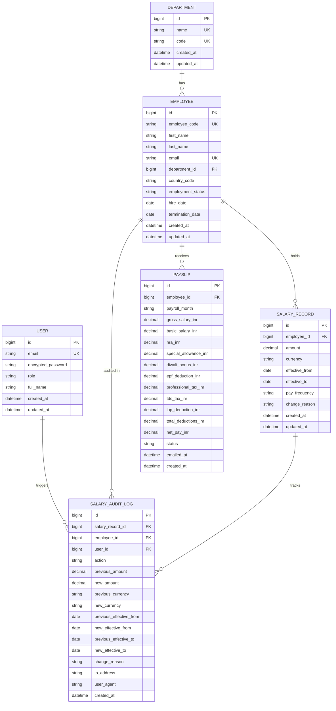

# Data Model & Business Rules Specification
## ACME Salary Management System

### 1. Entity-Relationship Overview
The database schema utilizes relational integrity, strict constraints, decimal monetary precision, and immutable audit logs.

---

### 2. Entity Specifications

#### A. `users`
Represents administrative and HR actors accessing the system.
- `id`: BIGINT AUTO_INCREMENT PRIMARY KEY
- `email`: VARCHAR(255) NOT NULL UNIQUE
- `encrypted_password`: VARCHAR(255) NOT NULL
- `role`: VARCHAR(50) NOT NULL DEFAULT `'hr_manager'` (Allowed: `admin`, `hr_manager`, `auditor`)
- `full_name`: VARCHAR(255) NOT NULL
- `created_at` / `updated_at`: DATETIME(6) NOT NULL

#### B. `departments`
Organizational units grouping employees.
- `id`: BIGINT AUTO_INCREMENT PRIMARY KEY
- `name`: VARCHAR(100) NOT NULL UNIQUE (e.g., Engineering, Sales, Product, Marketing, Operations, Finance, Human Resources)
- `code`: VARCHAR(20) NOT NULL UNIQUE (e.g., `ENG`, `SAL`, `PRD`, `MKT`, `OPS`, `FIN`, `HR`)
- `created_at` / `updated_at`: DATETIME(6) NOT NULL

#### C. `employees`
Core record for the 10,000 personnel.
- `id`: BIGINT AUTO_INCREMENT PRIMARY KEY
- `employee_code`: VARCHAR(20) NOT NULL UNIQUE (e.g., `ACME-00001` through `ACME-10000`)
- `first_name`: VARCHAR(100) NOT NULL
- `last_name`: VARCHAR(100) NOT NULL
- `email`: VARCHAR(255) NOT NULL UNIQUE
- `department_id`: BIGINT NOT NULL, FOREIGN KEY REFERENCES `departments(id)` ON DELETE RESTRICT
- `country_code`: VARCHAR(3) NOT NULL (ISO 3166-1 alpha-2 or alpha-3; e.g., `US`, `GB`, `IN`, `DE`, `SG`)
- `employment_status`: VARCHAR(30) NOT NULL DEFAULT `'active'` (Allowed: `active`, `on_leave`, `terminated`)
- `hire_date`: DATE NOT NULL
- `termination_date`: DATE NULL
- `created_at` / `updated_at`: DATETIME(6) NOT NULL

#### D. `salary_records`
Effective-dated salary assignments.
- `id`: BIGINT AUTO_INCREMENT PRIMARY KEY
- `employee_id`: BIGINT NOT NULL, FOREIGN KEY REFERENCES `employees(id)` ON DELETE CASCADE
- `amount`: DECIMAL(12, 2) NOT NULL (Precision 12, Scale 2: up to 9,999,999,999.99 with exact cent precision)
- `currency`: VARCHAR(3) NOT NULL (ISO 4217 uppercase standard; e.g., `USD`, `EUR`, `INR`, `GBP`)
- `effective_from`: DATE NOT NULL
- `effective_to`: DATE NULL (NULL signifies the current open-ended salary)
- `pay_frequency`: VARCHAR(20) NOT NULL DEFAULT `'annual'` (Allowed: `annual`, `monthly`)
- `change_reason`: VARCHAR(100) NOT NULL (e.g., `initial_hire`, `annual_merit`, `promotion`, `market_adjustment`)
- `created_at` / `updated_at`: DATETIME(6) NOT NULL

#### E. `salary_audit_logs`
Immutable audit entries recording every compensation revision.
- `id`: BIGINT AUTO_INCREMENT PRIMARY KEY
- `salary_record_id`: BIGINT NULL, FOREIGN KEY REFERENCES `salary_records(id)` ON DELETE SET NULL
- `employee_id`: BIGINT NOT NULL, FOREIGN KEY REFERENCES `employees(id)` ON DELETE RESTRICT
- `user_id`: BIGINT NOT NULL, FOREIGN KEY REFERENCES `users(id)` ON DELETE RESTRICT
- `action`: VARCHAR(30) NOT NULL (e.g., `create`, `update`, `supersede`, `terminate`)
- `previous_amount`: DECIMAL(12, 2) NULL
- `new_amount`: DECIMAL(12, 2) NOT NULL
- `previous_currency`: VARCHAR(3) NULL
- `new_currency`: VARCHAR(3) NOT NULL
- `previous_effective_from`: DATE NULL
- `new_effective_from`: DATE NOT NULL
- `previous_effective_to`: DATE NULL
- `new_effective_to`: DATE NULL
- `change_reason`: VARCHAR(255) NOT NULL
- `ip_address`: VARCHAR(45) NULL
- `user_agent`: VARCHAR(255) NULL
- `created_at`: DATETIME(6) NOT NULL

---

### 3. Business Rules & Integrity Invariants

1. **Current Salary Resolution**:
   - An employee's active salary is identified by:
     $$\text{effective\_from} \le \text{CURRENT\_DATE} \quad \text{AND} \quad (\text{effective\_to IS NULL} \lor \text{effective\_to} \ge \text{CURRENT\_DATE})$$
   - At any point in time, an employee can have at most one active salary record.

2. **Non-Overlapping Effective Date Invariants**:
   - For any employee, salary records $(A, B)$ must satisfy:
     $$A.\text{effective\_from} \le B.\text{effective\_to} \quad \text{AND} \quad B.\text{effective\_from} \le A.\text{effective\_to} \implies A.\text{id} = B.\text{id}$$
   - When a new revision starting on date $T$ is registered, the preceding open-ended record ($effective\_to = NULL$) must have its $effective\_to$ adjusted to $T - 1\text{ day}$.

3. **Monetary Precision & Multi-Currency Safety**:
   - Monetary values use `DECIMAL(12, 2)` to eliminate binary floating point rounding inaccuracies.
   - Aggregate compensation calculations (`SUM`, `AVG`, `MEDIAN`) are strictly grouped by `currency`. Disparate currencies are never summed without explicit exchange conversion rules.

4. **Transactional Audit Logging**:
   - Any insertion or update to `salary_records` occurs within an explicit database transaction with `salary_audit_logs`. If the audit record fails to insert, the entire salary change is rolled back.

---

### 4. Indexing Strategy
To guarantee fast query performance across 10,000 employees:
- `idx_employees_code`: UNIQUE (`employee_code`)
- `idx_employees_dept_status`: (`department_id`, `employment_status`)
- `idx_employees_country_status`: (`country_code`, `employment_status`)
- `idx_employees_name_search`: (`last_name`, `first_name`)
- `idx_salary_lookup`: (`employee_id`, `effective_from`, `effective_to`)
- `idx_salary_currency_amount`: (`currency`, `amount`)
- `idx_salary_audit_employee_created`: (`employee_id`, `created_at`)

---

### 5. Deterministic Seed Data Specification
- **Volume**: Exactly 10,000 synthetic employees.
- **Departments**: Distributed across 7 core departments (Engineering 30%, Sales 20%, Operations 15%, Product 10%, Marketing 10%, Finance 8%, HR 7%).
- **Geographies**: Distributed across 5 primary countries with native currencies:
  - United States (`US`): USD
  - United Kingdom (`GB`): GBP
  - Germany (`DE`): EUR
  - India (`IN`): INR
  - Singapore (`SG`): SGD
- **History Generation**:
  - 100% of employees have an initial salary record starting on their hire date.
  - ~40% of tenured employees have 1 to 3 historical salary revisions reflecting merit raises or promotions.
  - 100% of revisions generate matching audit log records.
