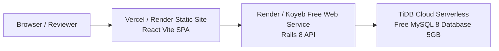

# 100% Free Deployment Guide
## ACME Salary Management System

This guide outlines two proven pathways to deploy the ACME Salary Management System **for 100% free with zero credit card required**.

---

## Path A: Full Cloud Deployment (Free Forever)

### Architecture


---

### Step 1: Provision a Free MySQL 8 Database (TiDB Cloud Serverless)
*TiDB Cloud Serverless is 100% free forever, fully MySQL 8 wire-compatible, provides 5 GB storage (easily accommodates 10,000+ employees), and requires no credit card.*

1. Go to [https://tidbcloud.com](https://tidbcloud.com) and sign in with GitHub or Google.
2. Click **Create Cluster** &rarr; Select **Serverless** (Free forever).
3. Choose your closest region (e.g. `US East / Oregon`).
4. Once created (~15 seconds), click **Connect**:
   - Under **Connect With**, select **General / MySQL CLI**.
   - Note down:
     - `Host`: e.g. `gateway01.us-east-1.prod.aws.tidbcloud.com`
     - `Port`: `4000`
     - `User`: e.g. `xxxxxx.root`
     - `Password`: (your generated password)
     - `Database`: `test` (or create `acme_salary_management_production`)

---

### Step 2: Deploy Rails 8 Backend (Render.com)
*Render provides a free Web Service tier with 512MB RAM and automated deployments from GitHub.*

1. Push your repository to GitHub:
   ```bash
   git remote add origin https://github.com/YOUR_USERNAME/acme-salary-management.git
   git push -u origin master
   ```
2. Log into [https://render.com](https://render.com).
3. Click **New +** &rarr; **Web Service**.
4. Connect your GitHub repository.
5. Configure the service:
   - **Name**: `acme-salary-backend`
   - **Language**: `Docker` (or `Ruby`)
   - **Root Directory**: `backend`
   - **Instance Type**: **Free**
   - **Health Check Path**: `/api/v1/health`
6. Add **Environment Variables**:
   | Variable | Value | Description |
   | :--- | :--- | :--- |
   | `RAILS_ENV` | `production` | Production mode |
   | `RAILS_SERVE_STATIC_FILES` | `true` | Static asset serving |
   | `SECRET_KEY_BASE` | *(Click "Generate")* | Rails secret key |
   | `DB_HOST` | `gateway01.xxxx.tidbcloud.com` | TiDB host from Step 1 |
   | `DB_PORT` | `4000` | Port |
   | `DB_USERNAME` | `xxxxxx.root` | TiDB user from Step 1 |
   | `DB_PASSWORD` | `your_tidb_password` | TiDB password from Step 1 |
   | `DB_NAME` | `test` | Database name |
   | `FRONTEND_URL` | `https://your-frontend.vercel.app` | (Update after Step 3) |
7. Click **Create Web Service**.
8. Once deployed, open the Render **Shell** tab to initialize and seed the 10,000 synthetic employees:
   ```bash
   bin/rails db:migrate
   bin/rails db:seed
   ```
9. Verify API health: `https://acme-salary-backend.onrender.com/api/v1/health`.

---

### Step 3: Deploy React Frontend (Vercel or Netlify)
*Vercel and Netlify offer 100% free static site hosting on high-speed global edge CDNs.*

#### Deploying on Vercel:
1. Log into [https://vercel.com](https://vercel.com).
2. Click **Add New...** &rarr; **Project** &rarr; Import your GitHub repository.
3. Configure project settings:
   - **Framework Preset**: `Vite`
   - **Root Directory**: Click edit and select `frontend`.
   - **Build Command**: `npm run build`
   - **Output Directory**: `dist`
4. Add **Environment Variable**:
   - `VITE_API_URL`: `https://acme-salary-backend.onrender.com` (Your Render backend URL from Step 2)
5. Update `frontend/vercel.json`:
   - Replace `YOUR_BACKEND_URL` in `frontend/vercel.json` with your Render backend domain to enable seamless single-origin proxying for session cookies and CSRF:
     ```json
     {
       "rewrites": [
         {
           "source": "/api/:path*",
           "destination": "https://acme-salary-backend.onrender.com/api/:path*"
         },
         {
           "source": "/(.*)",
           "destination": "/index.html"
         }
       ]
     }
     ```
6. Click **Deploy**.
7. In ~30 seconds, your site is live at `https://your-project.vercel.app`!
8. Go back to Render backend settings and set `FRONTEND_URL` to your Vercel URL.

---

## Path B: Instant Live Demo via Cloudflare Tunnel (2 Minutes)
*If you need an immediate public HTTPS URL to demonstrate the app with your locally seeded 10,000 employees without setting up external databases.*

### 1. Start Local Rails API & Vite Frontend
In terminal 1 (Backend):
```bash
cd backend
bin/rails server -p 3000
```

In terminal 2 (Frontend):
```bash
cd frontend
npm run dev
```

### 2. Expose via Cloudflare Tunnel (or LocalTunnel)
In terminal 3:
```bash
# Using Cloudflare Tunnel (Free, instant, no account required):
npx cloudflared tunnel --url http://localhost:5173

# OR using LocalTunnel:
npx localtunnel --port 5173
```
This generates a live public HTTPS URL (e.g. `https://random-subdomain.trycloudflare.com` or `https://neat-apple.loca.lt`) that anyone can open to interact with the full 10,000 employee system in real time!
